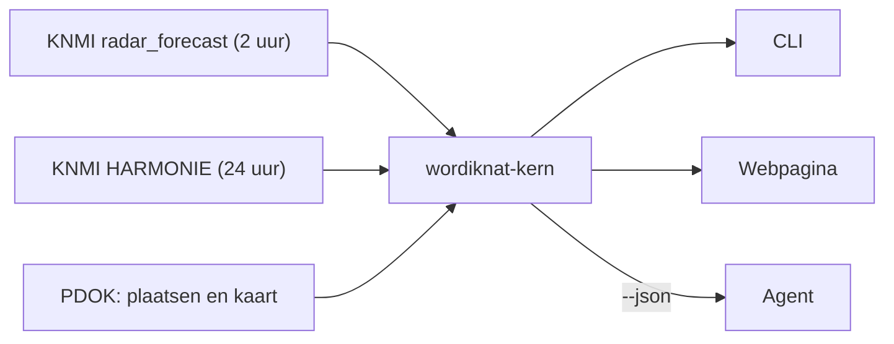

<p align="center">
  <picture>
    <source media="(prefers-color-scheme: dark)" srcset="docs/img/hero-donker.png">
    
  </picture>
</p>

<h1 align="center">wordiknat?</h1>

<p align="center">
  Regenverwachting voor de komende twee uur op KNMI-radardata, en per uur voor de komende 24 uur. Het antwoord eerst, lokaal op je eigen computer.
</p>

<p align="center">
  <a href="#snel-starten">Snel starten</a> ·
  <a href="#problemen">Problemen</a> ·
  <a href="#gebruik">Gebruik</a> ·
  <a href="#json-voor-agents">JSON voor agents</a> ·
  <a href="#agent-skill">Agent-skill</a> ·
  <a href="#english">English</a>
</p>

## Waarom wordiknat?

- Het antwoord staat bovenaan: "Over 10 min nat" of "Je blijft droog", daarna pas de details.
- Geen advertenties, trackers of account. Het draait lokaal.
- Je gebruikt je eigen gratis KNMI-sleutel; de data komt rechtstreeks van het KNMI.
- Mensen en agents krijgen hetzelfde antwoord: als tekst, als webpagina of als JSON.
- Verder vooruitkijken kan ook: `--24u` en het paneel "Komende 24 uur" geven de neerslag per uur voor de komende 24 uur, uit het HARMONIE-weermodel van het KNMI.

## Een voorbeeld

`npx wordiknat Utrecht` print het antwoord en een regel per tien minuten:

```text
Regen vanaf 14:15 (matig)
14:05                        0,00 mm/u
14:15  █                     0,20 mm/u
14:25  ███                   1,20 mm/u
14:35  ████                  1,90 mm/u
14:45  ███                   1,30 mm/u
14:55  █                     0,50 mm/u
15:05                        0,00 mm/u
15:15                        0,00 mm/u
15:25                        0,00 mm/u
15:35                        0,00 mm/u
15:45                        0,00 mm/u
15:55                        0,00 mm/u
16:05                        0,00 mm/u
Bron: KNMI (CC BY 4.0)
```

Wil je weten of het vanavond of vannacht nat wordt? `npx wordiknat Utrecht --24u` geeft de neerslag per uur:

```text
Regen vanaf 21:00 (zwaar)
14:00                        0,0 mm
...
20:00                        0,0 mm
21:00  █                     0,3 mm
22:00  ███                   1,1 mm
23:00  █████                 2,4 mm
00:00  ████████              3,8 mm
01:00  ████                  1,6 mm
02:00  ██                    0,6 mm
03:00  █                     0,2 mm
04:00                        0,0 mm
...
13:00                        0,0 mm
Bron: KNMI HARMONIE-model (CC BY 4.0)
```

De webpagina laat hetzelfde zien als grafiek, als radarkaart en als staafjes per uur:

<picture>
  <source media="(prefers-color-scheme: dark)" srcset="docs/img/pagina-donker.png">
  
</picture>

## Hoe het werkt



## Snel starten

Je hebt Node >= 22.18 nodig.

```bash
git clone https://github.com/CSundermanDVC/wordiknat
cd wordiknat
npm ci
cp .env.example .env     # zet je KNMI-sleutel achter KNMI_API_KEY=
npx wordiknat Utrecht
```

Voor de webpagina:

```bash
npm run build
npx wordiknat serve      # http://127.0.0.1:5173
```

Wil je `wordiknat` vanuit elke map gebruiken? Draai `npm link` in de projectmap. `.env` wordt alleen in de map gelezen waar je het commando start, dus zet `KNMI_API_KEY` (en eventueel `WORDIKNAT_LOCATION`) dan in je shellprofiel.

## Een gratis KNMI-sleutel

1. Vraag een sleutel aan op het [KNMI Developer Portal](https://developer.dataplatform.knmi.nl) voor de Open Data API. Dezelfde sleutel werkt voor de 2-uursverwachting (`radar_forecast`) en de 24-uursverwachting (`uwcw-ha-det-nl-s1`).
2. Zet hem in `.env` als `KNMI_API_KEY=<sleutel>`, of in je omgeving.

`.env` staat in `.gitignore`: de sleutel wordt nooit gecommit en wordiknat print hem nergens.

## Problemen

- **`MISSING_KEY` of `INVALID_KEY`:** staat `KNMI_API_KEY=` in `.env` in de map waar je het commando start? Een sleutel van het Developer Portal werkt pas als hij voor de Open Data API is uitgegeven.
- **`RATE_LIMITED`:** het KNMI weigert tijdelijk verzoeken. Wacht een paar minuten. wordiknat haalt zelf hooguit één radarbestand per 5 minuten en één modelbestand per uur op.
- **`UNKNOWN_PLACE`:** gebruik een woonplaatsnaam ("Utrecht", niet een straat) of geef coördinaten met `--lat` en `--lon`.
- **De webpagina blijft leeg:** draai eerst `npm run build`, daarna `npx wordiknat serve`.
- **Wat gaat er over de lijn?** Met `WORDIKNAT_DEBUG=1` zie je per verzoek de host en de status, zonder de sleutel.

## Gebruik

```text
wordiknat [<plaats>] [--lat <n> --lon <n>] [--24u] [--json] [--help]
wordiknat serve [--port <n>] [--host <adres>]
```

| Optie | Betekenis |
| --- | --- |
| `<plaats>` | Plaatsnaam, opgezocht via de PDOK-locatieserver |
| `--lat <n> --lon <n>` | Coördinaten in plaats van een plaats (samen op te geven) |
| `--24u` | Alleen de verwachting per uur voor de komende 24 uur (HARMONIE-model) |
| `--json` | Uitvoer als JSON, zie hieronder |
| `--help` | Toon het gebruik |
| `serve --port <n>` | Poort van de webpagina (standaard 5173) |
| `serve --host <adres>` | Adres om op te luisteren (standaard 127.0.0.1) |

Omgevingsvariabelen (ook uit `.env`):

- `WORDIKNAT_LOCATION`: standaardlocatie zonder argument, een plaatsnaam of `lat,lon`.
- `WORDIKNAT_DEBUG=1`: toon op stderr per verzoek de host en de status.

Let op: met `--host` een ander adres dan 127.0.0.1 kiezen maakt de pagina bereikbaar vanaf het netwerk, zonder authenticatie. Doe dat alleen op een vertrouwd netwerk.

Exitcodes: `0` gelukt, `1` bron-, netwerk- of datafout, `2` iets wat je zelf kunt oplossen (zie de tabel met foutcodes).

## JSON voor agents

`wordiknat <plaats> --json` schrijft één JSON-object met deze sleutels, in deze volgorde:

| Sleutel | Type | Betekenis |
| --- | --- | --- |
| `summary` | string | Eén Nederlandse zin, bijvoorbeeld "Regen vanaf 14:35 (licht)" |
| `willRain` | boolean | `true` als er in de resterende punten regen is (>= 0,1 mm/u) |
| `firstRainAt` | string of null | Tijdstip (ISO 8601) van het eerste regenpunt; `null` als het droog blijft |
| `dryUntil` | string of null | Tot wanneer het droog is (ISO 8601); `null` als het nu al regent |
| `maxMmPerHour` | number | Hoogste intensiteit in mm/u |
| `location` | object | `{ "name", "lat", "lon" }` |
| `issuedAt` | string | Uitgiftetijd van de verwachting (ISO 8601) |
| `points` | array | `{ "time", "mmPerHour" }` per 5 minuten |
| `source` | string | `KNMI radar_forecast 2.0 (CC BY 4.0)` |

```json
{
  "summary": "Regen vanaf 14:35 (licht)",
  "willRain": true,
  "firstRainAt": "2026-06-01T12:35:00.000Z",
  "dryUntil": "2026-06-01T12:35:00.000Z",
  "maxMmPerHour": 0.8,
  "location": { "name": "Utrecht", "lat": 52.09, "lon": 5.12 },
  "issuedAt": "2026-06-01T12:20:00.000Z",
  "points": [
    { "time": "2026-06-01T12:25:00.000Z", "mmPerHour": 0 },
    { "time": "2026-06-01T12:30:00.000Z", "mmPerHour": 0 },
    { "time": "2026-06-01T12:35:00.000Z", "mmPerHour": 0.8 }
  ],
  "source": "KNMI radar_forecast 2.0 (CC BY 4.0)"
}
```

`points` is hier ingekort; in het echt zijn het 25 punten van 5 minuten.

`firstRainAt` is `null` als het de komende twee uur droog blijft. `dryUntil` is het tijdstip waarop het droog blijft tot (het eerste regenpunt, of het laatste punt als het droog blijft) en is `null` als het al regent of er geen verwachting is.

### Met --24u

`wordiknat <plaats> --24u --json` schrijft één JSON-object met deze sleutels, in deze volgorde. Gebruik het voor vragen als "wordt het vannacht nat?"; voor de komende twee uur blijft de gewone aanroep nauwkeuriger.

| Sleutel | Type | Betekenis |
| --- | --- | --- |
| `summary` | string | Eén Nederlandse zin met het antwoord |
| `willRain` | boolean | `true` als er in de komende 24 uur regen is (>= 0,1 mm/u) |
| `firstRainAt` | string of null | Eerste regenuur (ISO 8601); `null` als het droog blijft |
| `dryUntil` | string of null | Tot wanneer het droog is; `null` als het al regent |
| `maxMmPerHour` | number | Hoogste intensiteit in mm/u |
| `intensity` | string of null | `licht`, `matig` of `zwaar`; `null` als het droog blijft |
| `location` | object | `{ "name", "lat", "lon" }` |
| `issuedAt` | string | Referentietijd van de modelrun (ISO 8601) |
| `hours` | array | `{ "time", "mmPerHour" }` per uur; `time` is het begin van dat uur |
| `source` | string | `KNMI HARMONIE-model uwcw-ha-det-nl-s1 1.0 (CC BY 4.0)` |

### Foutcodes

Bij een fout staat er `{"error":{"code","message"}}` op stdout en eindigt het proces met exitcode 1 of 2:

<details>
<summary>Foutcodes</summary>

| Code | Exit | Wanneer |
| --- | --- | --- |
| `MISSING_KEY` | 2 | Geen KNMI-API-sleutel gevonden |
| `INVALID_KEY` | 2 | Sleutel ongeldig of verlopen |
| `OUTSIDE_GRID` | 2 | Locatie buiten het radarbereik |
| `UNKNOWN_PLACE` | 2 | Plaats niet gevonden |
| `BAD_ARGS` | 2 | Ongeldige argumenten |
| `NO_LOCATION` | 2 | Geen locatie opgegeven |
| `RATE_LIMITED` | 1 | KNMI weigert tijdelijk verzoeken |
| `SOURCE_HTTP` | 1 | Onverwachte fout van de KNMI-bron |
| `NETWORK` | 1 | Geen verbinding met de bron |
| `BAD_FILE` | 1 | Radarbestand niet te lezen |
| `NO_DATA` | 1 | Geen radargegevens voor deze locatie |
| `TILE_UNAVAILABLE` | 1 | Kaartondergrond niet beschikbaar |
| `HOURLY_UNAVAILABLE` | 1 | 24-uursverwachting nu niet beschikbaar |
| `HOURLY_BAD_FILE` | 1 | Modelbestand voor de 24-uursverwachting niet te lezen |

</details>

## Agent-skill

Kopieer [`agent/SKILL.md`](agent/SKILL.md) naar de skills-map van je agent. Of zet dit fragment in de `AGENTS.md` van je project:

````markdown
## Regen
Vraagt de gebruiker of het gaat regenen of wanneer het droog is, draai `wordiknat <plaats> --json`.
Gaat de vraag over vannacht of morgenochtend, draai `wordiknat <plaats> --24u --json` (sleutel `hours` per uur).
Lees `summary` voor het antwoord in één zin en `willRain` voor ja of nee.
`firstRainAt` is het eerste regenmoment, `null` als het droog blijft.
`maxMmPerHour` geeft de intensiteit; de verwachting dekt twee uur.
Bij exitcode 1 of 2 staat in `error.message` wat er mis is; verzin dan geen verwachting.
Gebruik alleen een plaats die de gebruiker noemt of `WORDIKNAT_LOCATION`.
````

## Gegevensbronnen

- Neerslagverwachting (twee uur): KNMI `radar_forecast` 2.0, licentie CC BY 4.0.
- Neerslagverwachting (24 uur, `--24u`): KNMI HARMONIE-model `uwcw-ha-det-nl-s1` 1.0, licentie CC BY 4.0.
- Plaatsnamen: PDOK locatieserver. Kaart: BRT Achtergrondkaart, Kadaster/PDOK.

Dit zijn de enige externe verzoeken die wordiknat doet.

## Bijdragen

```bash
npm ci
npm run typecheck
npm test
npm run build
```

Houd `h5wasm` de enige runtime-dependency, schrijf de tekst in de interface in het Nederlands en maak kleine, gerichte pull requests.

Achtergrond bij de bronnen (Engels): [`docs/knmi-format.md`](docs/knmi-format.md) (radarbestand), [`docs/knmi-harmonie.md`](docs/knmi-harmonie.md) (HARMONIE-bestand) en [`docs/pdok-tiles.md`](docs/pdok-tiles.md) (kaarttegels).

## Licentie

MIT, zie [LICENSE](LICENSE).

## English

Wordiknat shows a rain forecast for the next two hours from KNMI radar data, and an hourly forecast for the next 24 hours from the KNMI HARMONIE model. It runs locally, with no ads, trackers or account.
```bash
git clone https://github.com/CSundermanDVC/wordiknat && cd wordiknat && npm ci   # Node >= 22.18
cp .env.example .env                  # add your free KNMI key as KNMI_API_KEY
npx wordiknat Utrecht                 # text answer
npx wordiknat Utrecht --json          # JSON for agents (nine keys, see "JSON voor agents")
npx wordiknat Utrecht --24u --json    # next 24 hours, hourly (HARMONIE model)
npm run build && npx wordiknat serve  # web page on http://127.0.0.1:5173
```
Get a free key at https://developer.dataplatform.knmi.nl; the same key covers both forecasts. It lives only in `.env` (read from the current directory) or the environment, and is never printed. Run `npm link` to use `wordiknat` from any directory. Background on the data sources is in [`docs/`](docs/).
